[](https://github.com/Nuulz/Roblox-Account-Manager/releases/latest)


# Roblox Account Manager 4

Una multiherramienta para quien usa varias cuentas de Roblox: guarda tus cuentas cifradas, ábrelas en el juego y servidor que quieras con un clic, y revisa sus Robux, limiteds, amigos y grupos desde un solo lugar.

La versión 4 es una reescritura completa en **Rust + Tauri** del [Roblox Account Manager original de ic3w0lf22](https://github.com/ic3w0lf22/Roblox-Account-Manager) (C#/WinForms). Está disponible en **español e inglés**.

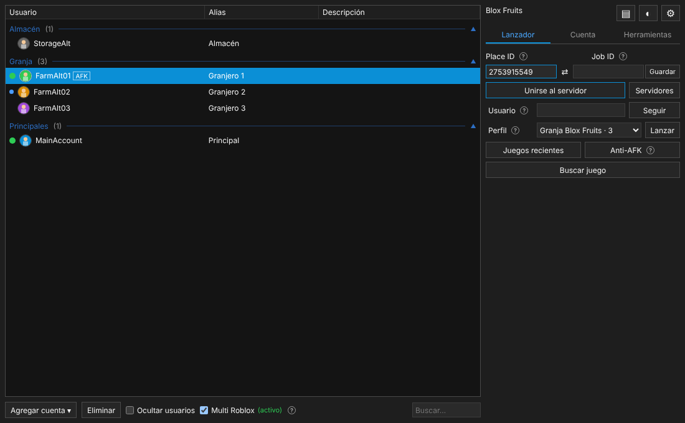

> **English:** Roblox Account Manager 4 is a full Rust + Tauri rewrite of ic3w0lf22's original account manager. The app is available in English and Spanish (Settings → Application → Language). See [Features](#funciones) for screenshots.

## Advertencia

- **Nunca compartas tu cookie `.ROBLOSECURITY` ni tu archivo `accounts.dat`.** Con la cookie, cualquiera puede usar tu cuenta sin la contraseña, gastar tus Robux o hacer que te la suspendan.
- Si alguien te pide que "copies la cookie" o que actives el servidor web con permisos peligrosos, no lo hagas.
- Algunos juegos no permiten cuentas alternativas. Infórmate antes de usarlas.

## Funciones

La ventana tiene tres pestañas: **Lanzador**, **Cuenta** y **Herramientas**. Los términos poco claros tienen un icono **?** que explica qué son.

### Lanzador

- **Unirse a un juego** con una o varias cuentas a la vez, a un servidor aleatorio, a uno concreto (Job ID) o a un servidor privado.
- **Seguir** a un usuario al juego en el que está.
- **Multi Roblox:** varias ventanas de Roblox abiertas a la vez, una por cuenta.
- **Perfiles de lanzamiento:** guarda "estas cuentas, en este orden, en este juego, con este retraso" y lánzalas con un clic.
- **Anti-AFK**, juegos recientes y favoritos, y guardar el Place/Job de cada cuenta.

### Cuenta

Todo lo de la cuenta seleccionada en un solo panel: Robux, correo verificado, PIN, alias y descripción, nombre visible, **trajes** (ponle un traje a varias cuentas a la vez), contraseña, correo, PIN, inicio de sesión rápido, cerrar otras sesiones, privacidad de seguimiento, solicitudes de amistad entre tus cuentas y usuarios bloqueados.

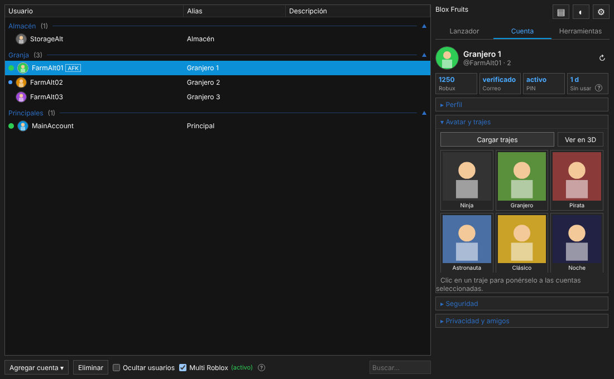

### Herramientas

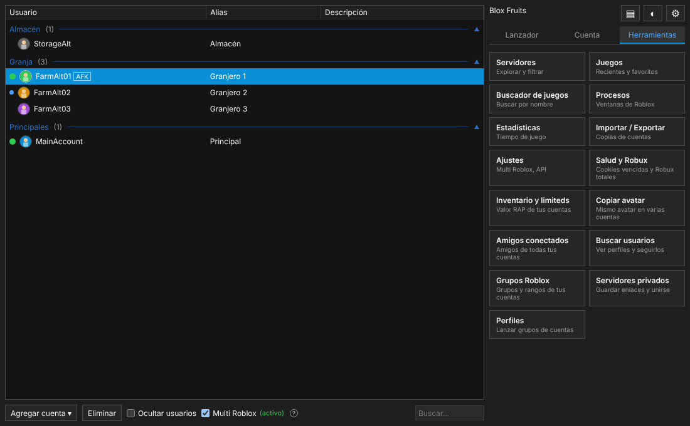

| Herramienta | Qué hace |
| :--- | :--- |
| **Salud y Robux** | Revisa todas las cuentas: detecta cookies vencidas o que pertenecen a otra cuenta, suma los Robux y muestra cuánto cambiaron desde la revisión anterior. También cuenta las solicitudes de amistad y los mensajes sin leer, que aparecen como "N avisos" en la lista. |
| **Inventario y limiteds** | Los limiteds de todas tus cuentas con su valor RAP y el total, con filtros por objeto y por cuenta. |
| **Amigos conectados** | Los amigos de todas tus cuentas en una lista: quién está en línea, en qué juego, y un botón para unirte con las cuentas que son sus amigas. |
| **Buscar usuarios** | Busca a cualquier usuario por nombre o ID, mira su perfil (nombres anteriores, insignias, grupos, limiteds, juegos favoritos) y síguelo a su juego con varias cuentas. |
| **Copiar avatar** | Pone a varias cuentas el mismo avatar que una de tus cuentas o que cualquier usuario. Solo usa objetos que cada cuenta ya tiene. |
| **Grupos Roblox** | En qué grupos está cada cuenta, con su rango, cuáles son tuyos y cuáles compartes entre cuentas. |
| **Servidores privados** | Guarda enlaces de servidores privados, incluidos los nuevos enlaces `roblox.com/share?code=…`, y únete con las cuentas que elijas. |
| **Buscador de juegos** | Busca juegos por nombre, mira jugadores conectados y % de likes, y mándalos al Lanzador. |
| **Servidores** | Lista de servidores de un juego con jugadores, ping, región y cuáles de tus cuentas están en cada uno. |
| **Procesos** | Las ventanas de Roblox abiertas, con memoria y tiempo; minimizar, cerrar o forzar el cierre. |
| **Estadísticas** | Tiempo jugado por cuenta y por juego, y el avatar en 3D. |
| **Importar / Exportar** | Copias de seguridad de tus cuentas. |

#### Salud y Robux
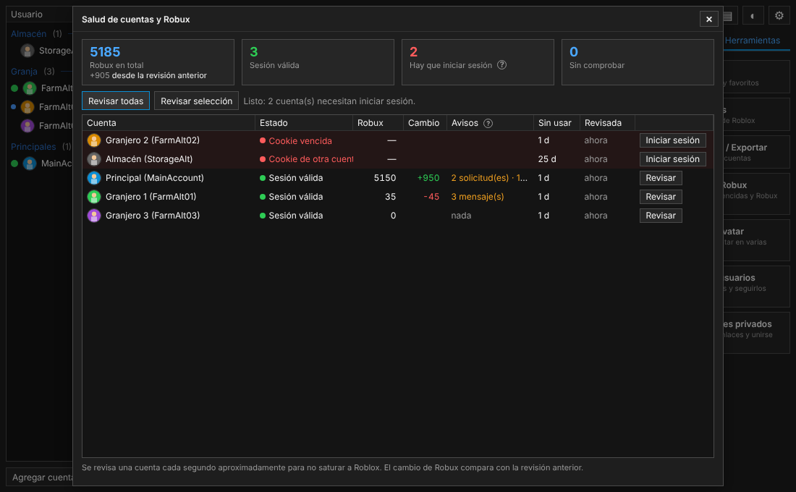

#### Inventario y limiteds
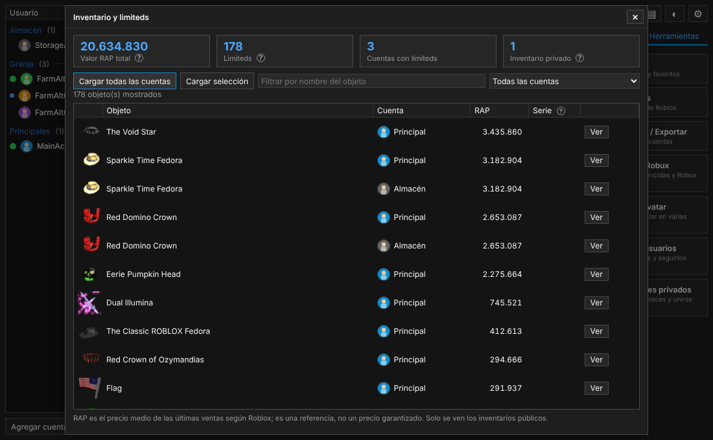

#### Amigos conectados
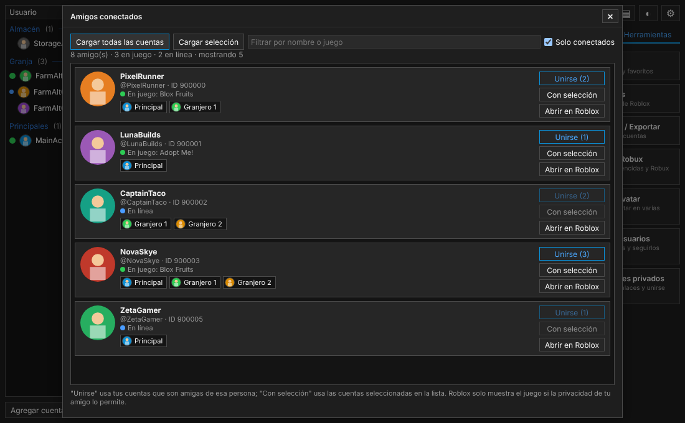

#### Buscar usuarios
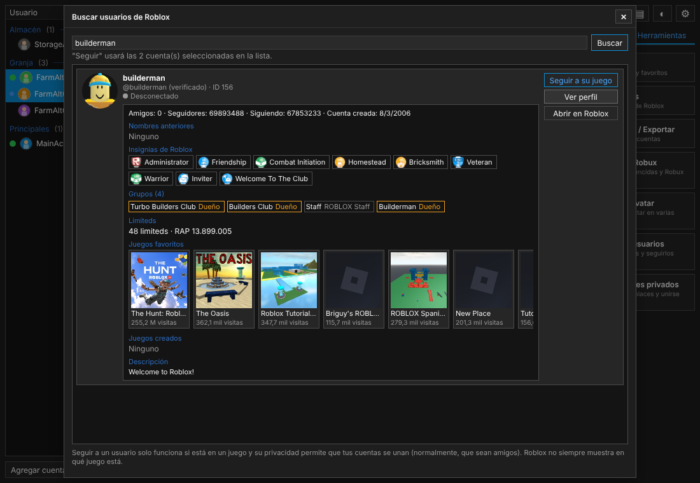

#### Copiar avatar
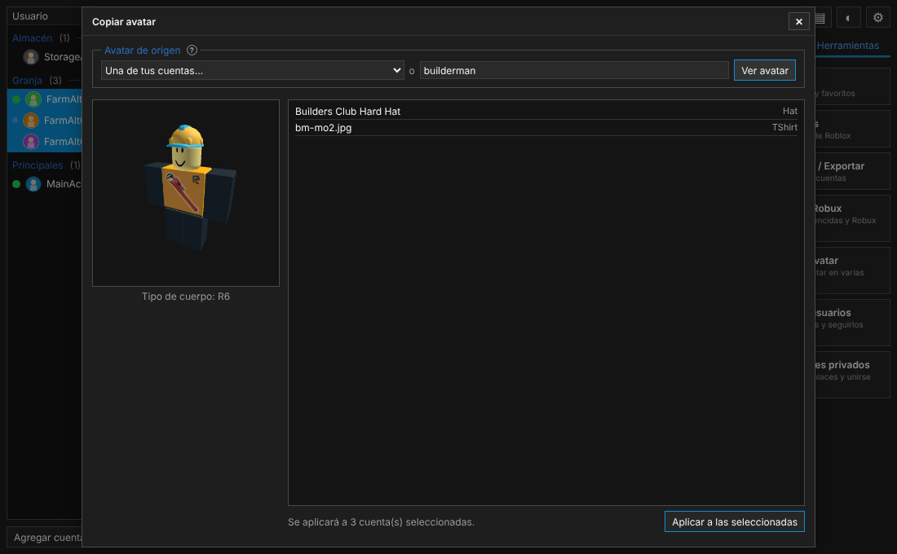

#### Grupos Roblox
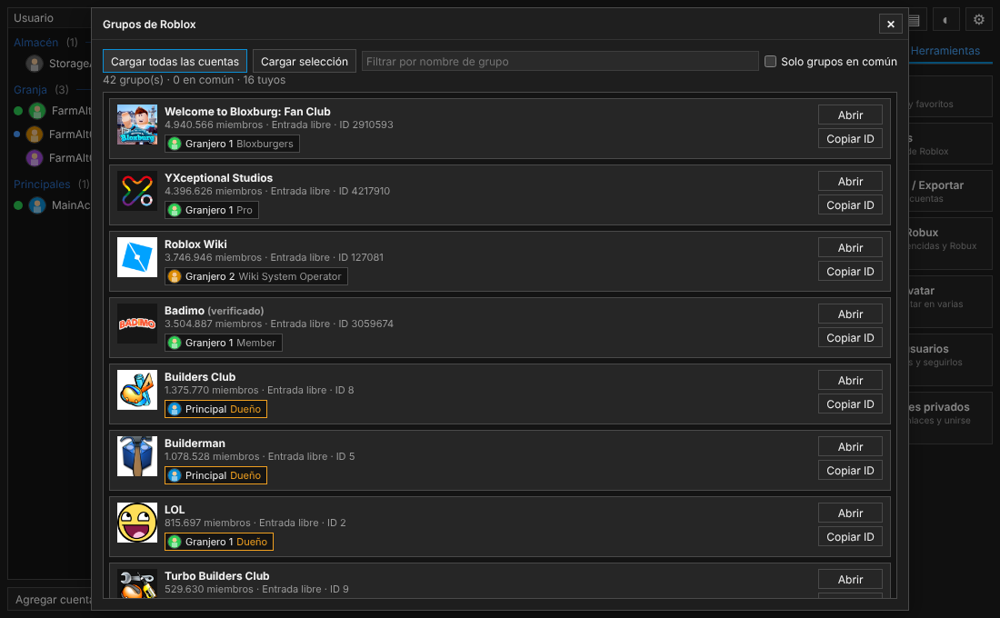

#### Servidores privados
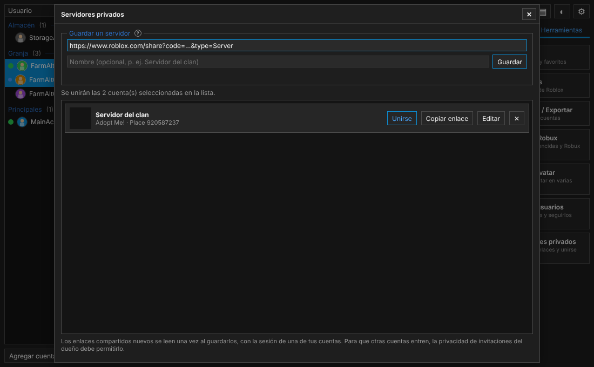

#### Buscador de juegos
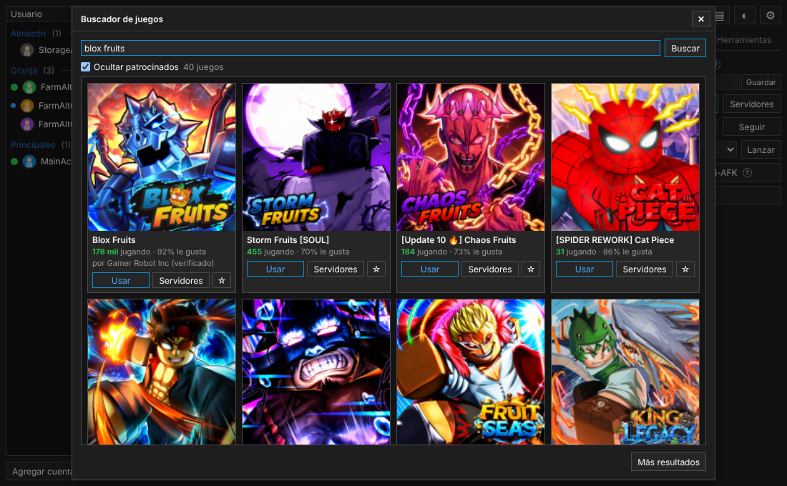

#### Perfiles de lanzamiento
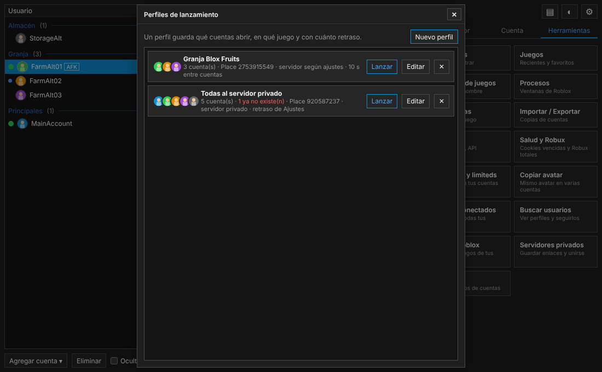
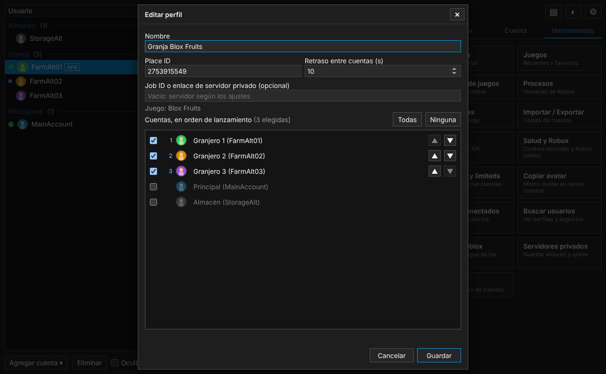

### Agregar cuentas

- **Iniciar sesión en el navegador:** abre la página de login de Roblox en una ventana propia; al entrar, la cuenta se agrega sola.
- **Por cookie:** pega la cookie `.ROBLOSECURITY`.
- **Volver a iniciar sesión:** si una cuenta vence, abre el login con su usuario y contraseña guardados ya escritos (una cuenta a la vez; tú pulsas "Iniciar sesión").
- **Abrir en el navegador:** roblox.com con la sesión de la cuenta, en un perfil de navegador propio para cada cuenta.

### Ajustes, ayuda e idioma

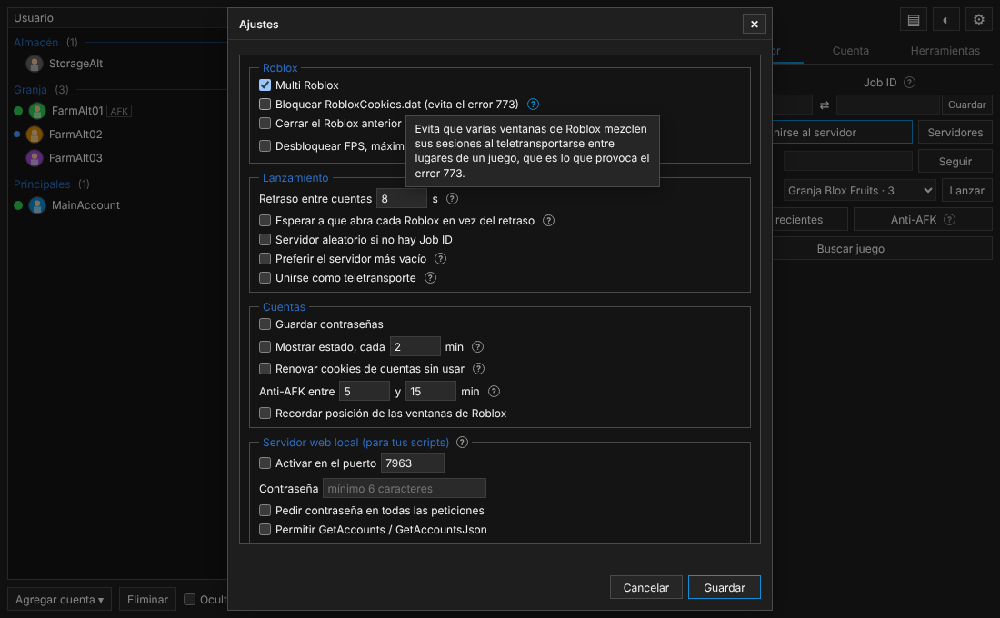

La app está en español e inglés y se cambia en **Ajustes → Aplicación → Idioma**, sin reiniciar.

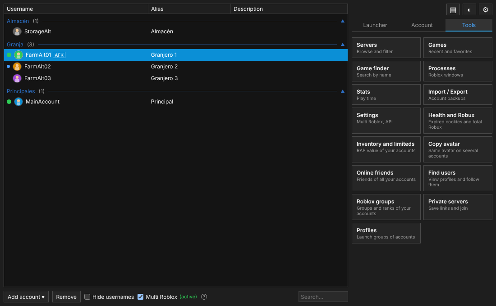

## Descarga

Descarga el instalador desde [Releases](https://github.com/Nuulz/Roblox-Account-Manager/releases/latest). La app busca actualizaciones al iniciar (se puede desactivar en Ajustes).

Requisitos: **Windows 10 u 11** y el [WebView2 Runtime de Microsoft](https://developer.microsoft.com/microsoft-edge/webview2/), que ya viene con Windows 11 y el instalador lo descarga si falta.

## Compilar desde el código

```bash
# Requisitos: Rust (rustup) y las herramientas de compilación de Visual Studio en Windows
cargo install tauri-cli --version "^2"
cd src-tauri
cargo tauri dev     # ejecutar en modo desarrollo
cargo tauri build   # crear el instalador (NSIS)
```

La interfaz es HTML/JS sin compilar, en `ui/`. El backend está en `src-tauri/src/`.

## Tus datos

Todo se guarda junto al ejecutable:

| Archivo | Contenido |
| :--- | :--- |
| `accounts.dat` | Tus cuentas, cifradas con tu usuario de Windows (DPAPI), con una contraseña maestra o sin cifrar, según elijas la primera vez. |
| `settings.json` | Ajustes. |
| `games.json`, `profiles.json`, `private_servers.json` | Juegos recientes y favoritos, perfiles de lanzamiento y servidores privados guardados. |
| `health.json`, `stats.json` | Última revisión de salud y estadísticas de juego. |
| `WebView2Data/` | Perfiles de navegador de cada cuenta. |

Si vienes de la versión 3, la app importa tu `AccountData.json` la primera vez que la abres.

## API local para scripts

Si la activas en **Ajustes → Servidor web local**, puedes controlar la app con peticiones HTTP a `http://localhost:7963/`. Métodos disponibles: `GetAccountsJson`, `GetCookie`, `GetCSRFToken`, `LaunchAccount`, `FollowUser`, `GetAlias`, `GetDescription`, `GetField`, `SetField`, `RemoveField`, `SetAvatar`, `ImportCookie`, `GetBlockedList`, `UnblockUser`, `UnblockEveryone` y `Running`.

Ponle una contraseña, y no actives `GetCookie` ni las conexiones desde otros equipos si no sabes exactamente por qué.

## Preguntas frecuentes

**¿Por qué el antivirus lo detecta como virus?**
Los programas de código abierto que manejan cookies, abren procesos o se actualizan solos a veces dan falsos positivos. El código está completo en este repositorio y puedes compilarlo tú mismo.

**¿Cómo activo Multi Roblox?**
Cierra todas las ventanas de Roblox, marca **Multi Roblox** abajo en la ventana principal o en Ajustes. Si sale "(bloqueado)", es que algún Roblox seguía abierto: ciérralo y haz clic en el aviso para reintentar.

**¿Puedo unirme a servidores privados?**
Sí. Pega el enlace en el campo Job ID o guárdalo en **Herramientas → Servidores privados**. Acepta el enlace clásico y el nuevo enlace para compartir. El dueño del servidor tiene que permitir las invitaciones.

**¿Por qué no puedo seguir a un amigo a su juego?**
Tiene que estar dentro de un juego y su privacidad tiene que dejar que tus cuentas se unan (normalmente, que sean amigos).

**¿Por qué no puedo lanzar muchas cuentas seguidas?**
Roblox limita las peticiones. Sube el **retraso entre cuentas** en Ajustes o usa un perfil de lanzamiento con más retraso.

**¿Funciona en Mac o Linux?**
No. Lanzar Roblox, Multi Roblox y el anti-AFK dependen de Windows.

**¿Me pueden suspender por usarlo?**
La app usa las mismas funciones que la web y el cliente de Roblox, pero algunos juegos prohíben las cuentas alternativas. Úsala bajo tu responsabilidad.

**¿Dónde reporto un error o pido una función?**
En [Issues](https://github.com/Nuulz/Roblox-Account-Manager/issues). Incluye capturas y los pasos para reproducirlo; el archivo `ram.log` junto al ejecutable ayuda mucho.

## Créditos

Basado en [Roblox Account Manager](https://github.com/ic3w0lf22/Roblox-Account-Manager) de **ic3w0lf22** y sus colaboradores. Licencia [GPL-3.0](LICENSE).
